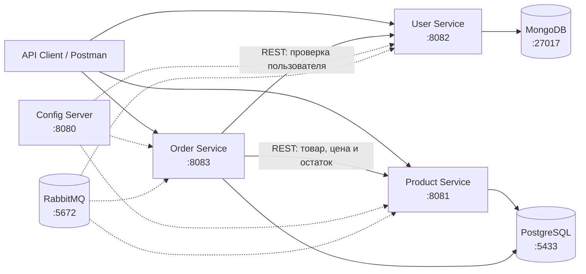

# E-Commerce Microservices

[](https://github.com/thess2r/Ecom/actions/workflows/ci.yml)

Backend-приложение интернет-магазина, построенное на Java и Spring Boot с использованием микросервисной архитектуры.

Проект включает отдельные сервисы для управления пользователями, товарами, корзиной и заказами. Централизованная конфигурация реализована через Spring Cloud Config, а синхронное взаимодействие между сервисами — через Spring `RestClient`.

## Возможности

- управление пользователями и адресами;
- создание, обновление и поиск товаров;
- контроль активности и количества товара;
- добавление и удаление товаров из корзины;
- создание заказа на основе корзины;
- проверка пользователя и товара через межсервисные HTTP-запросы;
- централизованная конфигурация микросервисов;
- динамическое обновление конфигурации через Spring Cloud Bus;
- мониторинг состояния сервисов через Spring Boot Actuator;
- запуск инфраструктуры через Docker Compose.

## Архитектура



## Микросервисы

| Сервис | Порт | Назначение | Хранилище |
|---|---:|---|---|
| `configserver` | 8080 | Централизованная конфигурация | Конфигурации из classpath |
| `user-service` | 8082 | Пользователи и адреса | MongoDB |
| `product-service` | 8081 | Каталог, цены и остатки | PostgreSQL |
| `order-service` | 8083 | Корзина и заказы | PostgreSQL |

## Технологии

- Java 17
- Spring Boot 3.2.5
- Spring Cloud 2023.0.x
- Spring Web MVC
- Spring `RestClient`
- Spring Cloud Config
- Spring Cloud Bus
- Spring Data JPA
- Spring Data MongoDB
- Hibernate
- PostgreSQL 14
- MongoDB 7
- RabbitMQ
- Spring Boot Actuator
- Maven
- Docker Compose
- Lombok
- JUnit 5, Mockito и AssertJ

## Структура проекта

```text
ecom-application/
├── configserver/             # Централизованная конфигурация
│   └── src/main/resources/config/
│       ├── user-service.yml
│       ├── product-service.yml
│       └── order-service.yml
├── user/                     # User Service
├── product/                  # Product Service
├── order/                    # Cart и Order Service
├── Monolith/                 # Материалы исходного монолита
├── docker/                   # Дополнительные Docker-ресурсы
├── docker-compose.yml        # PostgreSQL, MongoDB, RabbitMQ и pgAdmin
├── pom.xml                   # Maven reactor
└── README.md
```

## Требования

Перед запуском установите:

- JDK 17;
- Docker Desktop;
- Git.

Проверка Java:

```powershell
java -version
```

Проверка Docker:

```powershell
docker version
docker compose version
```

## Запуск проекта

### 1. Клонирование репозитория

```powershell
git clone https://github.com/thess2r/Ecom.git
cd Ecom
```

### 2. Запуск инфраструктуры

Убедитесь, что Docker Desktop запущен:

```powershell
docker compose up -d
```

Будут запущены:

| Компонент | Адрес |
|---|---|
| PostgreSQL | `localhost:5433` |
| MongoDB | `localhost:27017` |
| RabbitMQ | `localhost:5672` |
| RabbitMQ Management | `http://localhost:15672` |
| pgAdmin | `http://localhost:5050` |

Данные RabbitMQ:

```text
username: guest
password: guest
```

Данные pgAdmin:

```text
email: pgadmin4@pgadmin.org
password: admin
```

### 3. Сборка проекта

Из корневой директории:

```powershell
.\mvnw.cmd clean package -DskipTests
```

### 4. Запуск Config Server

Config Server необходимо запускать первым:

```powershell
.\mvnw.cmd -f configserver\pom.xml spring-boot:run
```

Проверка конфигурации:

```text
http://localhost:8080/user-service/default
http://localhost:8080/product-service/default
http://localhost:8080/order-service/default
```

### 5. Запуск микросервисов

Откройте отдельный терминал для каждого сервиса.

User Service:

```powershell
.\mvnw.cmd -f user\pom.xml spring-boot:run
```

Product Service:

```powershell
.\mvnw.cmd -f product\pom.xml spring-boot:run
```

Order Service:

```powershell
.\mvnw.cmd -f order\pom.xml spring-boot:run
```

### 6. Проверка состояния

```text
http://localhost:8082/actuator/health
http://localhost:8081/actuator/health
http://localhost:8083/actuator/health
```

## REST API

### User Service

Базовый URL:

```text
http://localhost:8082/api/users
```

| Метод | Endpoint | Описание |
|---|---|---|
| `GET` | `/api/users` | Получить всех пользователей |
| `GET` | `/api/users/{id}` | Получить пользователя |
| `POST` | `/api/users` | Создать пользователя |
| `PUT` | `/api/users/{id}` | Обновить пользователя |

Пример создания пользователя:

```bash
curl -X POST http://localhost:8082/api/users \
  -H "Content-Type: application/json" \
  -d '{
    "firstName": "Assanali",
    "lastName": "User",
    "email": "user@example.com",
    "phone": "+77000000000",
    "address": {
      "street": "Abay Street",
      "city": "Almaty",
      "state": "Almaty",
      "country": "Kazakhstan",
      "zipCode": "050000"
    }
  }'
```

### Product Service

Базовый URL:

```text
http://localhost:8081/api/products
```

| Метод | Endpoint | Описание |
|---|---|---|
| `GET` | `/api/products` | Получить активные товары |
| `GET` | `/api/products/{id}` | Получить товар |
| `GET` | `/api/products/search?keyword=...` | Поиск товаров |
| `POST` | `/api/products` | Создать товар |
| `PUT` | `/api/products/{id}` | Обновить товар |
| `DELETE` | `/api/products/{id}` | Деактивировать товар |

### Order Service

#### Корзина

Базовый URL:

```text
http://localhost:8083/api/cart
```

Запросы требуют заголовок:

```text
X-User-ID: <MongoDB user ID>
```

| Метод | Endpoint | Описание |
|---|---|---|
| `GET` | `/api/cart` | Получить корзину |
| `POST` | `/api/cart` | Добавить товар |
| `DELETE` | `/api/cart/items/{productId}` | Удалить товар |

При добавлении товара `order-service`:

1. проверяет пользователя через `user-service`;
2. запрашивает товар через `product-service`;
3. проверяет активность и остаток;
4. получает актуальную цену;
5. сохраняет товар в корзине.

Пример:

```bash
curl -X POST http://localhost:8083/api/cart \
  -H "Content-Type: application/json" \
  -H "X-User-ID: USER_ID" \
  -d '{
    "productId": 1,
    "quantity": 2
  }'
```

#### Заказы

| Метод | Endpoint | Описание |
|---|---|---|
| `POST` | `/api/orders` | Создать заказ из корзины |

```bash
curl -X POST http://localhost:8083/api/orders \
  -H "X-User-ID: USER_ID"
```

## Тестирование

Запуск всех тестов:

```powershell
.\mvnw.cmd test
```

Тесты межсервисной логики корзины:

```powershell
.\mvnw.cmd -f order\pom.xml -Dtest=CartServiceTest test
```

## Остановка инфраструктуры

Остановить контейнеры:

```powershell
docker compose down
```

Остановить и удалить Docker volumes:

```powershell
docker compose down -v
```

> Команда с `-v` удаляет сохранённые данные PostgreSQL, MongoDB и pgAdmin.

## Docker-образы и production Compose

После успешного CI workflow `Publish Docker images` собирает образы для `linux/amd64` и `linux/arm64` и публикует их в GitHub Container Registry:

```text
ghcr.io/thess2r/ecom-configserver
ghcr.io/thess2r/ecom-user
ghcr.io/thess2r/ecom-product
ghcr.io/thess2r/ecom-order
```

Для запуска полного стека на сервере создайте production-файл окружения:

```bash
cp .env.example .env
```

Замените значения `change-me` в `.env` на уникальные пароли, затем запустите:

```bash
docker compose --env-file .env -f compose.production.yml pull
docker compose --env-file .env -f compose.production.yml up -d
```

Файл `.env` исключён из Git и не должен попадать в репозиторий.

Production Compose запускает четыре приложения, PostgreSQL, MongoDB и RabbitMQ в общей закрытой Docker-сети. Адреса баз данных и микросервисов передаются приложениям через переменные окружения без использования `localhost` между контейнерами.

## Текущий статус

Реализовано:

- разделение монолита на микросервисы;
- PostgreSQL и MongoDB;
- Config Server;
- Spring Cloud Bus;
- синхронное взаимодействие через `RestClient`;
- проверка пользователя и товара при работе с корзиной;
- unit-тесты логики корзины.

Планируется:

- Service Discovery с Eureka;
- API Gateway;
- централизованная обработка ошибок;
- Resilience4j;
- JWT-аутентификация;
- асинхронное взаимодействие через RabbitMQ;
- централизованные логи и метрики;
- контейнеризация самих микросервисов.

## Автор

GitHub: [@thess2r](https://github.com/thess2r)
